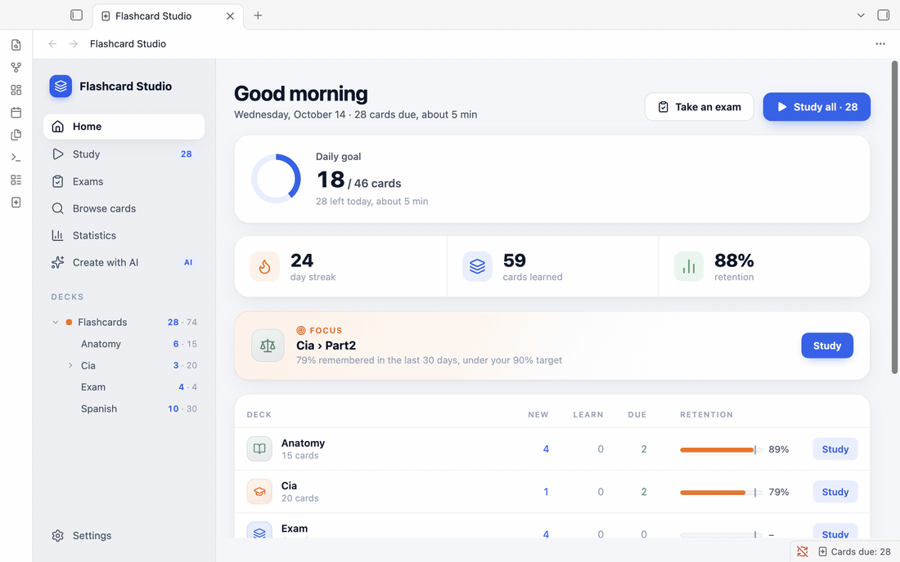

# Flashcard Studio

**An Obsidian plugin for flashcards that live in your notes, with the scheduling and control you know from Anki, and a study screen made for focus.**

<picture>
  <source media="(prefers-color-scheme: dark)" srcset="docs/media/hero-dark.png">
  
</picture>



Flashcard Studio turns the Markdown you already write into spaced repetition flashcards, and schedules them with [FSRS](https://github.com/open-spaced-repetition/fsrs4anki/wiki/The-Algorithm), the modern algorithm Anki uses. It keeps a full review history, so you can undo an answer and see how your memory is doing. Every card and every review stays in plain files in your vault, and it works the same on desktop and on your phone.

> Flashcard Studio reads and writes the same note format as the [Spaced Repetition](https://github.com/st3v3nmw/obsidian-spaced-repetition) plugin, so your existing cards and schedules work unchanged, and you can switch back at any time. See [Compatibility and credits](#compatibility-and-credits).

## Highlights

- **A study screen made for focus.** One card at a time, with the deck and "4 / 17" at the top and a progress bar that fills with the colour of each answer you give. Tap to reveal, then answer with soft tiles that show when you will see the card again.
- **An interface for the desktop.** On a computer it opens as a full tab with a sidebar, a dashboard home and, while you study, a side panel with what is known about the card, how the session is going and the keys. The phone keeps its own screens.
- **Learn diagrams.** Image occlusion hides parts of a picture, with an editor that works with a mouse and with a finger, one card for each mask.
- **More ways to answer.** Multiple choice cards from a plain checklist, typed answers that show which letters were wrong, and cards read aloud with your device's voices.
- **Know where you are weak.** The statistics rank your decks by how well you remembered them in the last 30 days, against your target, and the home screen puts the weakest one first with one tap to study it.
- **Fix mistakes while they are fresh.** At the end of a session, **Review mistakes** goes over exactly the cards you missed.
- **Practise like the real thing.** Exams with a timer from your multiple choice cards, or all your cards, with a question map, a score against your pass mark and the score of each deck, progress that survives closing the tab, and one tap to study what you missed.
- **Anki's scheduling.** FSRS with learning steps, Anki's learn ahead limit, daily limits, custom study, and an optimizer that fits FSRS to your own reviews.
- **Full control.** Undo, suspend, bury, flags and leeches, and a card info screen with every review of a card.
- **Cards written for you.** Generate cards from a note with your own AI provider (Anthropic, OpenAI or a local model), look them over, and add only the ones you want.
- **Bring your Anki decks.** Import `.apkg` and text files with their media and decks, and export back to Anki.
- **Your data stays yours.** Cards and schedules are plain text in your notes, and the review history is plain files that sync between devices without conflicts.
- **Light and dark, desktop and phone.**

<picture>
  <source media="(prefers-color-scheme: dark)" srcset="docs/media/screenshots/statistics-desktop.png">
  
</picture>

## Writing cards

Tag a note with `#flashcards`, or turn folders into decks in the settings. Then write cards in any of these styles:

```markdown
What is the capital of France::Paris
Question and answer both ways:::Reversed card

**What is the purpose of internal auditing?**
?

- Provide independent, objective assurance and consulting
- Add value and improve an organisation's operations

The CAE reports ==functionally== to the ==board==.

> [!question]- What is the capital of France?
> Paris
```

- `Question::Answer`: single-line card.
- `Question:::Answer`: single-line card, reviewed in both directions.
- `?` on its own line: multi-line card (`??` for both directions).
- `==highlight==`, `**bold**` or `{{curly braces}}`: cloze deletions.
- A callout of type `flashcard`, `question` or `card`: a card. The title is the front and the body is the back.
- With a start and an end marker set in the settings (for example `+++` on the line before and after a card), a card can have blank lines, tables and several paragraphs, also in its question.
- Two more options in the settings: a cloze card that is only the line with the cloze, and `\cloze{answer}{hint}` for clozes inside LaTeX math, with optional sequence numbers and overlapping (`\cloze[2]{answer}`).

Images, audio, LaTeX, code and footnotes work inside cards, because Obsidian renders them.

### Image occlusion

Hide parts of a picture and guess what is under them, which is how you learn a diagram, a map or an anatomy plate.

Run **Add image occlusion** from the command palette, or from the editor menu, and choose an image from your vault. Drag on the picture to draw a rectangle or an ellipse, drag a mask to move it, drag its handles to resize it, and type what is under it in the answer field. It works with a mouse and with a finger. A mask smaller than 1% of the picture is ignored, and Delete removes the selected mask.

````text
```image-occlusion
image: [[Heart.png]]
mode: hide-all
question: Name the labelled chamber
mask: a1 rect 0.1250 0.3000 0.1800 0.0950 | Left ventricle
mask: b2 ellipse 0.5500 0.2200 0.1400 0.0800 |
````

````

- Every mask is one card. Coordinates are fractions of the picture, so the masks fit it at any size.
- **Hide all, guess one** (the default) draws every mask and asks about one at a time, as Anki does. **Hide one, guess one** draws only the mask that is asked about.
- On the front the mask that is asked about is filled and the others are grey. On the back it turns into an outline, and its answer is shown under the picture. The picture is as wide as the card, so what is written on it can be read, and the card scrolls to the mask that is asked about. On the back, click or tap the picture, or the magnifier in its corner, to zoom. On the front a click or tap on the picture shows the answer, like any card.
- The schedules of the masks share one `<!--SR:...-->` comment after the block, like the deck of a cloze card. Editing a block in the editor moves each schedule with its mask: delete a mask and the others keep theirs, and a new mask starts as a new card.
- In a note, the block shows the picture with every answer on its mask and a pencil that reopens the editor. The Spaced Repetition plugin sees a code block and no card.
- **Edit masks in the editor, not by hand, once a block has been reviewed.** Schedules follow the masks by their position in the block. The editor moves each schedule with its mask. If you delete or break a `mask:` line in the text, the schedules that come after it move onto the wrong masks. A block that has no image, or no mask that reads, is not a card, and its schedule comment is left as it is.
- The image is a link to a file, and Obsidian does not update links inside code blocks. If you rename or move the image, the card shows "Image not found" and keeps its schedule; change the `image:` line to the new name.
- **Edit card** in the study screen opens the same editor with the masks locked: you can move and resize them, change their answers and the question, but not add or delete a mask, because the cards of the block are in the queue. Add or delete masks from the note.
- Anki has no such card in its basic model, so an export writes one basic note per mask, with the question and the whole picture on the front and the answer on the back.

## Reviewing

Run **Flashcard Studio: Review flashcards from all notes** from the command palette, or click the ribbon icon. Rate each card **Again**, **Hard**, **Good** or **Easy**. After an answer, a toast shows when you will see the card again, with an **Undo** button.

| Key | Action |
| --- | --- |
| Space or Enter | Show answer, then Good |
| 1, 2, 3, 4 | Again, Hard, Good, Easy (Anki keys) |
| Ctrl/Cmd + Z, or U | Undo last answer |
| - | Bury until tomorrow |
| @ | Suspend |
| Ctrl/Cmd + 1 to 7 | Flag (red, orange, green, blue, pink, turquoise, purple) |
| S | Skip |

The number keys follow **Answer keys** in the settings. **Anki** (1 Again, 2 Hard, 3 Good, 4 Easy) is the default for new installs. **Original** (1 Hard, 2 Good, 3 Easy, 0 Reset the card) is the layout of the Spaced Repetition plugin, and existing installs keep it until you change the setting.

On a phone, the same actions are in the card menu.

### Multiple choice

A card whose answer is a task list with at least two items, at least one of them checked, is a multiple choice card. No new syntax:

```markdown
Which body sets the internal audit charter?
?
- [ ] The CAE
- [x] The board
- [ ] External auditors
- [ ] Senior management
Explanation: the board approves the charter (Standard 6.2).
````

Lines after the list are the explanation, shown after you answer. Text before the list stays above the options. In the Spaced Repetition plugin this is an ordinary card, so your notes keep working there.

In a review the options are tiles. Tap one, or press its number (1 to 9), and the answer shows with the right option in green, a wrong choice in red, and the explanation. The rating the answer suggests, **Good** for a right choice and **Again** for a wrong one, is outlined and tagged **Suggested**; you still choose the rating. With several checked options the question says **Select all that apply**; choose them and press **Check**. To see the answer without choosing, press Space or tap the question, and nothing is suggested. **Shuffle options** in the settings (on by default) shows the options in a new order each time.

Only a real checklist counts. A list with one item, with nothing checked, with nested items or a plain bullet among the items, or a second list after other text, stays an ordinary card.

Multiple choice works with `?`, which is one direction. With `??` you get a second card as well: its front is the checklist, shown as an ordinary list of checkboxes, and its back is the question.

### Typing the answer

Turn on **Type the answer** in the settings, or **Type answers** in the card menu for one session. A card whose answer is short plain text (one line, at most 120 characters, no image, code, math, table or list) shows a field under the question. Press Enter to check. You see what you typed with each wrong letter marked, and the expected answer below it with the letters you left out marked. **Good** is suggested for an exact answer and **Again** otherwise. Case, extra spaces and a full stop at the end do not count, and accents do unless you turn on **Ignore accents**.

Cloze cards get a field in place of each blank, and the same rules mark them right or wrong. That part follows the setting; the card menu switch does not change it.

An image occlusion card asks for the label of the mask it is about, when that label is short plain text. The picture with the outlined mask is the answer, and what you typed is checked under it.

### Read aloud

The speaker button in the card, or the **R** key, reads the side you see with your device's own voices, offline. Images, code and math are skipped, and a cloze blank is read as "blank". A multiple choice card reads its options, and after you answer, the right one and the explanation. In the settings you can read the question or the answer aloud as soon as it shows, and choose the voice and the speed. Where a device cannot speak, the button and the settings are not shown.

## AI cards

Run **Flashcard Studio: Generate cards with AI** from the command palette, or choose it in the editor's context menu, on a note or on a selection. Choose how many cards (up to 50), which kinds (basic, reversed, cloze, multiple choice), any extra instructions, and whether the cards go into this note, under a **Flashcards** heading, or into a new note next to it. A preview lists the cards: untick the ones you do not want, edit any text, then choose **Add**. The plugin writes the cards in your notes' own syntax and reads each one back with its own parser before adding it. A card that would not read back as itself, for example one with `::` in its question, is shown unticked with the reason, until you edit it. A note without a flashcards tag gets one.

Set it up in **Settings, AI cards**: pick Anthropic, OpenAI or any OpenAI-compatible server such as Ollama, LM Studio or OpenRouter (enter its address, for example `http://localhost:11434/v1`), a model name and your API key. The key is kept in Obsidian's secret storage, not in the plugin's settings file. A local server needs no key. This needs Obsidian 1.13.1 or later.

Many local servers cut a long note short without saying so (Ollama's default context is 4096 tokens), so raise the context length there when you generate from long notes.

## The desktop interface

On a computer, Flashcard Studio opens as a full tab with a sidebar, in place of a window over your notes.

- The **sidebar** has Home, Study (with the number of cards due), Exams, Browse cards, Statistics and Create with AI, then your decks with the cards due and the total of each, and Settings. Click a deck to study it; decks with subdecks open and close.
- The **home** is a dashboard: a greeting with the number of cards due and about how long they take, **Take an exam** and **Study all**, your daily goal, the streak, the cards learned and the retention, the deck that needs focus, your last exam with **Retake**, your decks with their retention against your target, your activity over the last six months and the next seven days.
- While you **study**, the sidebar shrinks to a strip of icons so that the card gets the room. The card is up to 780 px wide, with the rating tiles and their keys under it, and the rating that the answer suggests is outlined. The panel on the right shows **This card** (its state, when you last saw it, its stability, how well you would recall it now, its lapses and your last five answers), **This session** (your answers, the time and the cards left) and the **Keys**.
- Clicking or pressing an item of the sidebar leaves the keyboard to the screen it opens, so Space shows the answer of the card in front of you.
- A pane narrower than 900 px, for example a split, gets the layout of the phone, and the desktop layout returns when it widens. A study session is never dropped by a change of size or of tab: the switch waits until you are back on the deck list.
- **Desktop layout** in **Settings, UI preferences** (on by default) turns it off. It is only read on a computer, applies to the Studio look (the Classic look keeps its window), and opens the tab whatever **Open in new tab** says. Turn it off if you prefer a window over your notes, or the layout of the phone in a tab. The phone always has its own screens.

## Exams

Run **Flashcard Studio: Take an exam** from the command palette, press **Take an exam** on the home screen, or choose **Exams** in the desktop sidebar. Choose the decks, the number of questions, a time limit (or none) and which cards to ask: **Multiple choice only**, or **All cards**, where a card with a short plain answer is typed and any other card is one you mark yourself after looking at the answer. An image occlusion card is typed too when the label of its mask is short plain text. Two presets fill it in: **Quick check** (20 questions, no limit) and **CIA simulation** (125 questions, 150 minutes). Cloze cards and suspended cards are never asked, and an exam never changes the schedule of a card.

The exam shows one question at a time, with "12 / 125" and the time left at the top. The time turns orange under five minutes, and the exam is submitted when it reaches zero. Flag a question to come back to it. The question map, beside the question on a desktop and a sheet from the bottom on a phone, shows what is answered and what is flagged, and jumps to any question. Press 1 to 9 to choose an option, the left and right arrows to move, F to flag and Enter to go on; the keys are read by where they are on the keyboard, so they work on an Arabic or an AZERTY layout, and they only work while the exam is the pane you are in. **Submit** asks first, and says how many questions are unanswered or flagged.

Your progress is saved as you go: after every answer, flag and move, and when you pause typing, and only when something changed. If you close the tab, or quit Obsidian, the exam is still there. Obsidian offers to **Resume exam** when it starts, and **Exams** lists it first. A timed exam keeps its deadline: time passes while it is closed, as in a real exam, and one that ran out is submitted as you left it. **Discard** (two presses) or **Leave** in the exam throws it away. An exam is resumed on the device that started it.

The results show your score against the pass mark, the time taken, the score of each deck, and every question with your answer, the right one and the explanation. The pass mark is 75% until you change it in **Settings, Exams**. The CIA reports a scaled score, so this is a practice target, not the official pass mark. **Study the ones I missed** starts a review of exactly those cards, and a question left unanswered counts as missed.

Each exam is saved as one plain file in `Flashcard Studio/Exams/`, for example `2026-09-30 1405 exam.md`: a summary table, and one JSON line for each question. The setup lists your last five exams and starts from the last one, so a retake is one press of **Start exam**.

## Compared with Spaced Repetition

|                                                      | Spaced Repetition | Flashcard Studio |
| ---------------------------------------------------- | ----------------- | ---------------- |
| Cards written in plain Markdown                      | ✓                 | ✓                |
| FSRS scheduling                                      | ✓                 | ✓                |
| Works on iPhone, iPad and Android                    | ✓                 | ✓                |
| Review history of every answer                       |                   | ✓                |
| Undo last answer                                     |                   | ✓                |
| Daily new card and review limits                     |                   | ✓                |
| Suspend, bury and flag cards; leech detection        |                   | ✓                |
| FSRS learning steps, learn ahead limit and optimizer |                   | ✓                |
| Custom study (forgotten, ahead, preview, by deck)    |                   | ✓                |
| Heatmap, true retention, study time and weak areas   |                   | ✓                |
| Review mistakes after a session                      |                   | ✓                |
| A desktop interface with a sidebar and a dashboard   |                   | ✓                |
| Image occlusion cards                                |                   | ✓                |
| Multiple choice cards                                |                   | ✓                |
| Typed answers                                        |                   | ✓                |
| Read aloud                                           |                   | ✓                |
| Exams with a timer, a score and results to study     |                   | ✓                |
| Cards written by your own AI provider                |                   | ✓                |
| Import from and export to Anki                       |                   | ✓                |
| Sync without conflicts across devices                |                   | ✓                |

## Where your data lives

- **The schedule of each card** is an HTML comment after the card: `<!--SR:!fsrs,...,id=k3f9a2-->`. It is the same format the Spaced Repetition plugin uses, plus a short card id and optional markers (`susp`, `bury=`, `flag=`, `leech`) that the Spaced Repetition plugin ignores.
- **Your review history** is in `Flashcard Studio/Review log/`, with one Markdown file per device per month (for example `2026-09 iphone-81c2.md`). Each answer is one line of JSON. Because every device writes only its own files, syncing with Obsidian Sync, iCloud or any other service never creates conflicts.
- **Your exams** are in `Flashcard Studio/Exams/`, one Markdown file each. Like the review log, they are never read as cards. An exam in progress is kept in a file of its own in the plugin's folder (`exam-drafts/`, one file for each exam and device, named like the review log's files) until it is submitted or discarded, so it never touches your settings.
- **Settings** are in the plugin's `data.json`.

These plain files make it easy for scripts or AI assistants to read your progress and add cards.

## Installing

1. In Obsidian, open **Settings, Community plugins** and choose **Browse**.
2. Search for **Flashcard Studio**, then choose **Install** and **Enable**.

Or open [Flashcard Studio in the community directory](https://community.obsidian.md/plugins/flashcard-studio) and choose **Install**.

**Beta versions.** To try a release before it reaches the directory, install [BRAT](https://github.com/TfTHacker/obsidian42-brat) from the community plugins, run **BRAT: Add a beta plugin for testing** and enter `Almalkiid/flashcard-studio`.

**Coming from Spaced Repetition?** Disable it and enable Flashcard Studio. Your cards and schedules work as they are. To keep your settings, use **Settings, Data, Import settings from Spaced Repetition**.

## Network use

Flashcard Studio works offline. It makes a network request only in two cases:

- You turn on **Show update available status bar item** in the settings (it is off by default). Flashcard Studio then asks GitHub for the latest release of this repository, at most once a day while the status bar item is shown, and compares its version number with yours. The request carries no information about you or your notes.
- You run **Generate cards with AI**, which sends the note or selection you chose, and your extra instructions, to the provider you set up in the settings. Nothing is sent until you choose **Generate**.

## Compatibility and credits

- Flashcard Studio reads and writes the note format of the [Spaced Repetition](https://github.com/st3v3nmw/obsidian-spaced-repetition) plugin, so cards and schedules you already have carry over.
- The memory model is [FSRS](https://github.com/open-spaced-repetition/ts-fsrs), through the ts-fsrs library.

All source code in this repository is original to Flashcard Studio, apart from the public-domain cyrb53 hash (by bryc), which card ids depend on. Third-party libraries are used as dependencies under their own licenses (see [THIRD-PARTY-NOTICES.md](THIRD-PARTY-NOTICES.md)).

## License

MIT. See [LICENSE](LICENSE).
