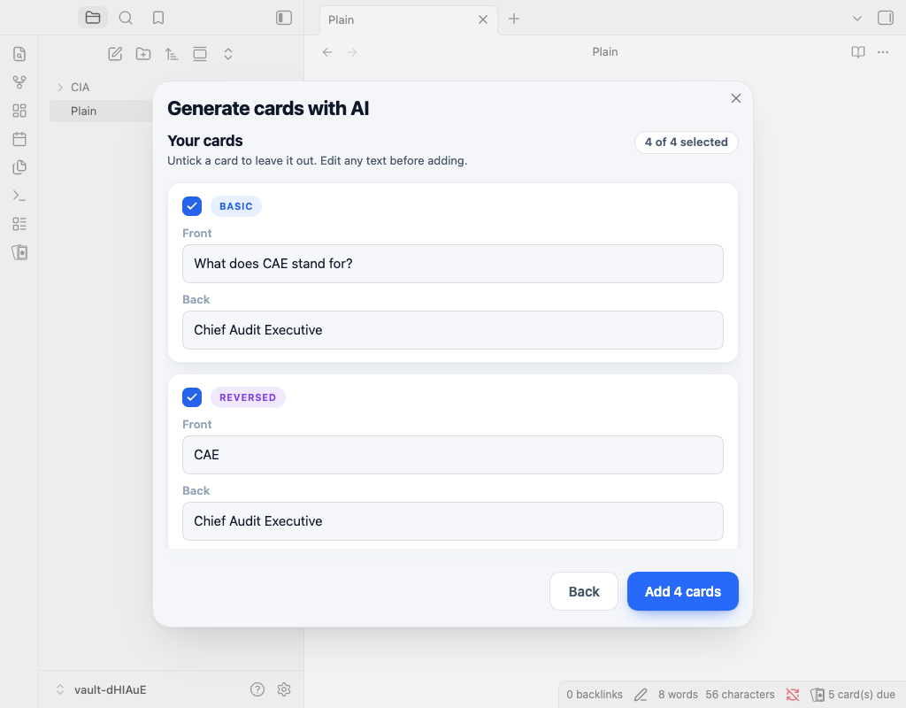

# AI card generation

Run **Flashcard Studio: Generate cards with AI** from the command palette or an editor context menu. You can generate from a note or selection, choose up to 50 cards, select basic, reversed, cloze, and multiple-choice formats, give extra instructions, then add them to the current note, a `Flashcards` section, or a new neighbouring note.

The preview lets you edit or untick cards before adding them. Flashcard Studio parses every result before it writes it, so invalid cards remain unticked with a reason.

Configure the provider in **Settings → AI cards**:

- **Anthropic** is the default provider and model is `claude-sonnet-5-5`.
- **OpenAI** accepts an exact model name.
- **Compatible server** accepts an OpenAI-compatible URL, such as `http://localhost:11434/v1` for Ollama.

Select or create an API key in Obsidian's secret storage. The key is not kept in the plugin settings file. A local server usually needs no key. Nothing is sent until you run generation; the selected note or selection and your instructions go only to the configured provider.

