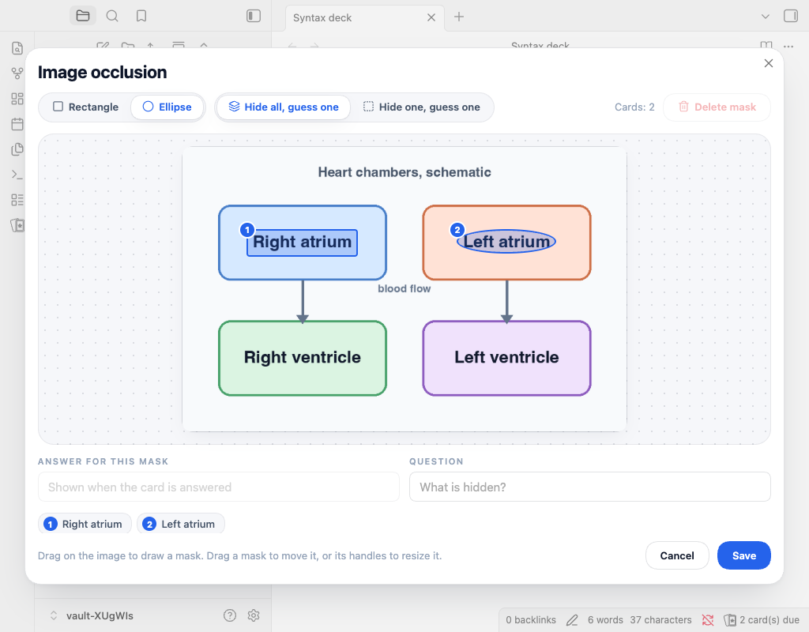
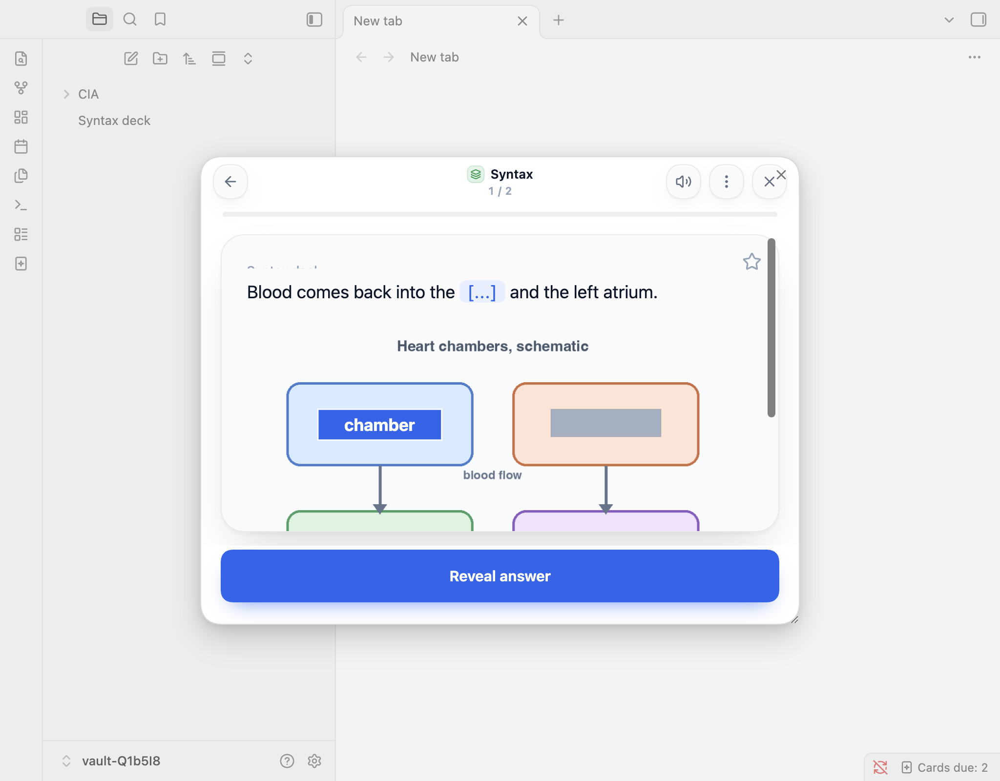

# Image occlusion

Image occlusion makes one card for each labelled mask on an image. Run **Flashcard Studio: Add image occlusion** from the command palette or editor menu, choose an image, draw rectangles or ellipses, and enter each answer.

````markdown
```image-occlusion
image: [[Heart.png]]
mode: hide-all
question: Name the labelled chamber
mask: a1 rect 0.1250 0.3000 0.1800 0.0950 | Left ventricle
mask: b2 ellipse 0.5500 0.2200 0.1400 0.0800 |
```
````

To limit the note preview to 240 pixels wide, write `image: [[Heart.png|240]]` or `image: `. To fit it in a box, write `[[Heart.png|300x200]]` or ``: the picture keeps its proportions. Each block can have its own width. The picture and masks shrink together in narrower panes. Review cards use their usual size.

**Hide all, guess one** is the default: every mask appears while one is asked. **Hide one, guess one** shows only the current mask. On the answer, tap the image or its magnifier to zoom.

Edit reviewed masks in the occlusion editor, not by editing `mask:` lines yourself. The editor maintains schedules as masks move. If you rename or move the image, update the `image:` line because Obsidian does not update links inside code blocks. A schedule comment is shared after the block.

````markdown
```image-occlusion
image: [[Map.png]]
mode: hide-one
question: Name the country
mask: c1 rect 0.1 0.1 0.2 0.2 | France
```
````

```

`hide-all` and `hide-one` are accepted modes. A block without a readable image or mask is not a card; a mask smaller than 1% of the image is ignored. Each accepted mask is a card, but the block has one shared scheduling comment.


```

## Image cloze

An image cloze block asks its masks like text clozes. Each mask says on which cards it is asked, and can carry a hint. There is no answer field: the answer is the part of the picture under the mask. Run **Add image cloze** (a command, and an item in the editor menu on a line with an image).

````markdown
The ==1;;left ventricle== pumps blood to the ==2;;aorta==.

```image-cloze
image: [[Heart.png]]
mode: hide-all
question: Name the chamber
mask: 1   | a5l rect 0.3617 0.3182 0.2958 0.3116 | chamber
mask: 2   | b2k rect 0.1000 0.2000 0.1500 0.1000 |
mask: ash | c9x ellipse 0.5500 0.2200 0.1400 0.0800 | valve
mask: 0   | d4m rect 0.7000 0.7000 0.1000 0.1000 |
```
````

- **Cards for a mask**: card numbers as in Anki (`1`, or `1,2` for several cards), `0` for a mask that is always hidden, or overlap letters, one per card: `a` asked, `h` hidden, `s` shown. Past its last letter a mask is shown.
- **Hint**: everything after the second `|`. It is written on the mask while the mask is asked; without one the mask shows `?`.
- **Mode**: for number fields, `hide-all` hides the masks that are not asked, and `hide-one` shows them. A `0` mask is hidden in both.
- **Text and picture together**: text clozes in the same paragraph share card numbers with the masks, so card 1 asks text cloze 1 and every mask with `1`. In Anki this needs a template change. A block on its own makes one card for each number its masks ask on, and none for a number nothing asks.
- **Schedules** follow card numbers: each segment of the schedule comment ends with `c=<number>`. Adding a text cloze, moving or splitting masks, or deleting a mask and putting it back before the next review keeps every card's schedule.

Differences from Anki:

- When no mask or text cloze asks on a number any more, that card's schedule is removed the next time the card's note is written, as for a removed text cloze. Anki keeps the empty card until **Empty Cards**. The editor names such numbers before you save.
- A hidden mask that covers an asked one still covers it on the back, as in Anki.

Older versions of Flashcard Studio do not support notes with an image cloze block: they show it as code and may give its schedules to the wrong cards. Image cloze cards are left out of exams, as text clozes are, and are not exported to Anki yet (the export counts them as skipped).


