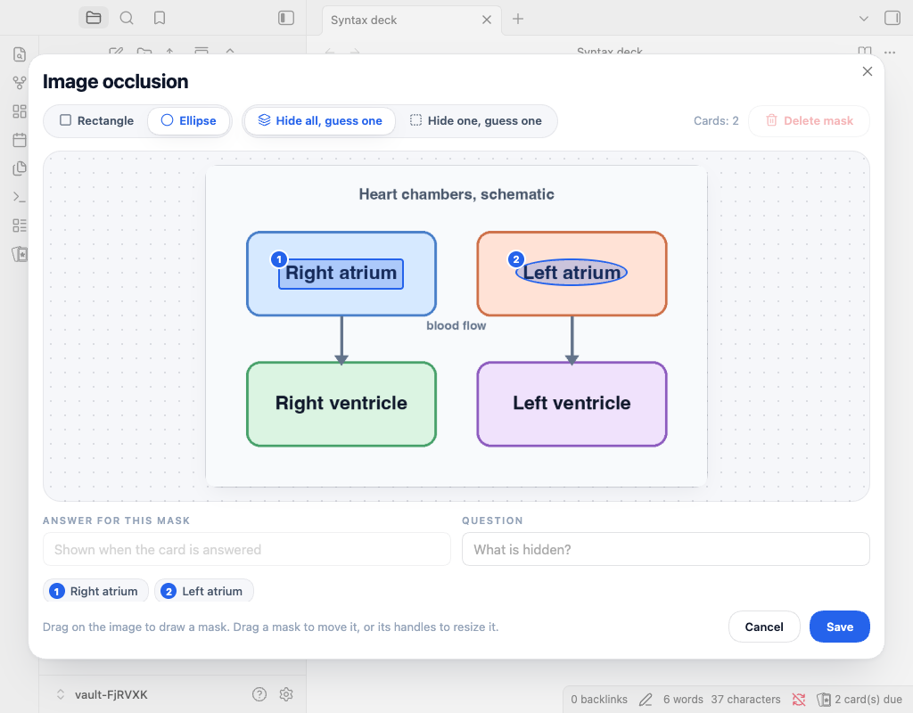

# Image occlusion

Image occlusion makes one card for each labelled mask on an image. Run **Flashcard Studio: Add image occlusion** from the command palette or editor menu, choose an image, draw rectangles or ellipses, and enter each answer.

````markdown
```image-occlusion
image: [[Heart.png]]
mode: hide-all
question: Name the labelled chamber
mask: a1 rect 0.1250 0.3000 0.1800 0.0950 | Left ventricle
mask: b2 ellipse 0.5500 0.2200 0.1400 0.0800 |
```
````

**Hide all, guess one** is the default: every mask appears while one is asked. **Hide one, guess one** shows only the current mask. On the answer, tap the image or its magnifier to zoom.

Edit reviewed masks in the occlusion editor, not by editing `mask:` lines yourself. The editor maintains schedules as masks move. If you rename or move the image, update the `image:` line because Obsidian does not update links inside code blocks. A schedule comment is shared after the block.

````markdown
```image-occlusion
image: [[Map.png]]
mode: hide-one
question: Name the country
mask: c1 rect 0.1 0.1 0.2 0.2 | France
```
````

```

`hide-all` and `hide-one` are accepted modes. A block without a readable image or mask is not a card; a mask smaller than 1% of the image is ignored. Each accepted mask is a card, but the block has one shared scheduling comment.


```
