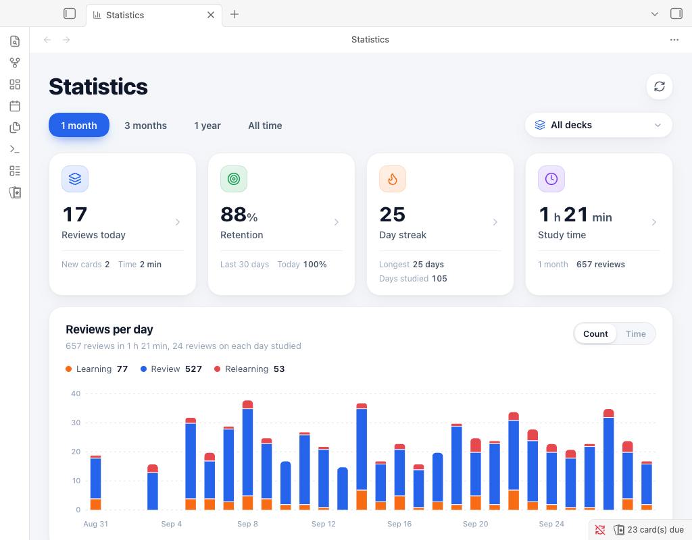
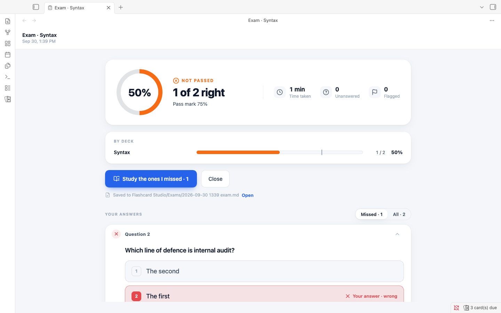

# Statistics and exams

## Statistics

Open **Statistics** to view activity, review count and time, retention, future due cards, card states, intervals, stability, difficulty, retrievability, answer buttons, and weak areas. Choose a deck and time range to narrow the view. Statistics fill in from your review log and can be refreshed.

Weak areas rank decks by recent retention against your target. A deck appears after ten review answers in the last 30 days.

## Exams

Run **Take an exam** from the command palette, dashboard, or desktop sidebar. Choose decks, question count, an optional time limit, and either multiple-choice only or all eligible cards. Cloze and suspended cards are excluded. An exam never changes a flashcard schedule.

The included presets are **Quick check** (20 questions, no limit) and **CIA simulation** (125 questions, 150 minutes). You can flag questions, use the question map, and resume an unfinished exam on the device that started it. Results show the score, pass-mark comparison, deck scores, answers, and **Study the ones I missed**. The default pass mark is 75%.

